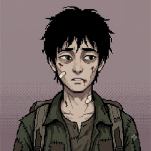
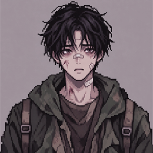
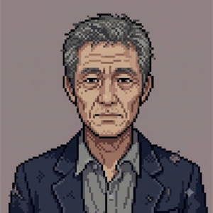
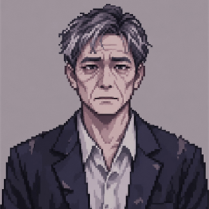
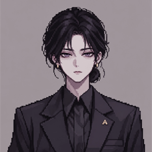

# [회의록] 팀 프로젝트 2차 – 프로토타입 시연, 기획 역할 나누기, QA 진행 방식

## ■ 기본 정보

- 일시: 2026년 11월 10일(화) 18:00 ~ 19:00 (기억 기준, 녹음 없음)
- 장소: 7203 강의실
- 참석자: 최동환(팀장), 노단비, 윤신재, 김도경 (총 4명)
- 불참: 없음
- 작성자: 최동환 (서기)
- 이번 회의 목표: 프로토타입을 시연하고, 기획 작업과 QA 진행 방식을 정한다.
- 변경 없음: 팀명, 팀 룰 — 1차 참고

## ■ 지난 회의 Action Item 점검

| 과제 | 담당자 | 상태 | 비고 |
| --- | --- | --- | --- |
| 검문 기본 시스템 프로토타입 | 최동환 | 완료 | 이번 회의에서 시연 (안건 1) |
| 비슷한 게임 시스템 분석 | 윤신재 | 완료 | 기본 시스템 12개 + 핵심 시스템 제안 4개. 페이퍼 플리즈 위주 |
| 디자인 방향 논의 | 노단비, 김도경 | 완료 | 인물 6명 이미지 프롬프트 정리 (안건 3) |
| 각자 할 일·일정 공유 | 노단비 → 최동환 | 완료 | |
| 스토리 보완, 엔딩 구체화 | 노단비 | 진행 중 | 큰 흐름은 있음. 구체화는 덜 됨 (안건 2) |
| AI 이미지 툴 선정 | 전원 | 완료 | 이번 회의에서 결정 (안건 3) |

- 윤신재 과제물 내용
  - 기본 시스템 12개: 판정 버튼 3개(통과·거부·구금), 위반 통지서, 근무 시간과 급여, 등급제, 생활비, 검사기, 심문, 규정집, 뉴스·신문, 뇌물, 비밀 조직, 가족
  - 핵심 시스템 제안 4개:
    - **정책 카드**: 매주 금요일 2장 중 1장 선택, 최대 2칸 장착
    - **신념**: 규율–연민 막대. 선처 대상이 오면 [거부]·[선처] 버튼
    - **압수 물품 처분**: 금지 물품을 압수하고 신고할지, 몰래 쓸지 선택
    - **특권층**: 서류에 문제가 있는 특권층이 주 0~3명. 정부 쪽지를 따르면 규율·배급 증가, 어기면 연민 증가와 불리한 카드 1장

## ■ 팀 운영 변경

- 역할 변경: 기획을 스토리와 시스템으로 나눈다. 바뀐 사람만 적는다.

| 이름 | 역할 | 비고 |
| --- | --- | --- |
| 노단비 | 스토리 기획, 서브 시스템 기획, 메인 디자인 | 지금 스토리는 노단비가 모두 구상함 |
| 윤신재 | 시스템 기획, QA | 다른 게임 경험을 살려 시스템을 찾음 |

## ■ 논의 안건

### 안건 1. 프로토타입 시연

- 논의 내용: 검문 프로토타입을 함께 플레이했다. 기획과 화면(인터페이스)을 어떻게 채울지 상의했다. 이야기하다 보니 기획 이야기가 필요해져 안건 2로 이어졌다.
- **결정 사항**: 시연에서 나온 내용은 기획 소회의에서 정리한다.
  - 담당자: 노단비, 윤신재
  - 일정: 주회의 전날 18:00까지 개발에 전달
  - 목표: 다음 버전에 반영

### 안건 2. 기획 역할 나누기와 회의 방식

- 논의 내용: 스토리와 큰 흐름은 있다. 구체화는 많이 덜 됐다. 마감이 1월 말이라 기획 완성이 급하다. 최동환이 기획을 나누자고 제안했고, 팀원 의견도 같았다.
  - **노단비**: 스토리 기획과 서브 시스템 기획.
  - **윤신재**: 시스템 기획. 주회의마다 과제를 받는다. 비슷한 게임을 해 보거나 자료를 모아, 넣으면 재미있을 시스템을 고른다.
  - **소회의**: 시스템 기획은 스토리 기획과 계속 맞춰야 한다. 주회의 외에 1주 2~3회 소회의를 한다(디스코드 또는 대면).
  - **개발 반영**: 소회의·디자인 결과 중 넣어 볼 만한 것은 주회의 전날 18:00까지 개발에 넘긴다. 개발은 주회의 전까지 게임에 넣어, 업데이트된 게임을 주회의에 가져온다.
  - **다음 주회의**: 업데이트된 게임을 시연한다. 시연한 게임을 QA 과제로 낸다.
- **결정 사항**: 기획을 스토리(노단비)와 시스템(윤신재)으로 나누고, 주 1회 주회의와 주 2~3회 소회의로 진행한다.
  - 담당자: 노단비, 윤신재, 최동환
  - 일정: 11/10부터
  - 목표: 매주 주회의에서 새 버전 플레이

### 안건 3. 디자인 공유와 AI 이미지 툴

- 논의 내용: 노단비(메인 디자인)와 김도경(서브 디자인)이 상의한 내용을 공유했다.
  - **그림체**: 저해상도 픽셀아트, 정면 상반신, 회보라색 단색 배경, 굵은 외곽선 없음, 디더링 음영.
  - **인물 6명**: 김00(15세 여), 한00(26세 남), 강00(56세 남), 진00(20대 후반 남), 박00(30세 여, 표정 2개), 최00(31세 여, A급 관료).
  - **도구 비교**: 같은 프롬프트로 제미나이와 지피티를 비교했다. 결과 그림은 맨 아래 첨부 표 참고.
- **결정 사항**: AI 이미지 툴은 GPT로 확정하고, 월 29,000원 요금제를 결제한다. 비용은 4명이 똑같이 나눈다. 인물 확정은 스토리가 정해진 뒤로 보류한다.
  - 담당자: 전원(비용), 노단비·김도경(디자인)
  - 일정: 인물 확정은 스토리 확정 후

### 안건 4. QA 진행 방식

- 논의 내용: 최동환이 QA 설계도를 만들어 QA 인원(윤신재, 김도경)에게 보여 주었다.
  - **파일 2개**: 보고서(적는 칸만)와 안내서(적는 법)로 나눈다.
  - **버전마다**: 게임 버전이 바뀌면 그 버전의 보고서와 안내서를 나눠 준다.
  - **대상**: 첫 프로토타입은 QA를 받지 않는다. 주회의에서 시연한 버전을 그 주의 QA 과제로 낸다.
  - **내는 법**: 끝나면 디스코드에 올린다. 또는 주회의 때 함께 확인한다.
  - **파일 이름**: 보고서는 `QA_{버전}_{이름}.pdf`, 사진은 `QA_{버전}_{이름}_{번호}.png`.
- **결정 사항**: 주회의에서 시연한 버전을 QA 과제로 내고, 버전마다 QA 보고서를 받는다.
  - 담당자: 최동환(양식), 윤신재·김도경(QA)
  - 일정: 11/17 주회의부터

## ■ 결정 사항 요약

| 결정 사항 | 담당자 | 일정 | 목표 |
| --- | --- | --- | --- |
| 기획을 스토리(노단비)·시스템(윤신재)으로 나눔 | 노단비, 윤신재 | 11/10부터 | 1월 말 마감 전 기획 완성 |
| 주 1회 주회의 + 주 2~3회 기획 소회의 | 노단비, 윤신재 | 11/10부터 | 소회의 결과를 주회의 전날 18:00까지 개발로 전달 |
| AI 이미지 툴 GPT 확정 (월 29,000원, 4명이 나눠 냄) | 전원 | 11/10 | 디자인 작업에 사용 |
| 인물 이미지 확정 보류 | 노단비, 김도경 | 스토리 확정 후 | 스토리에 맞는 인물 확정 |
| 주회의에서 시연한 버전을 QA 과제로 냄 (보고서·안내서 배포) | 최동환, 윤신재, 김도경 | 11/17부터 | 버전마다 QA 보고서 회수 |

## ■ Action Items (다음 회의까지)

| 담당자 | 과제 | 목표(완료 기준) | 마감일 |
| --- | --- | --- | --- |
| 노단비, 윤신재 | 기획 소회의 2~3회 | 소회의 결과를 개발에 전달 | 11/16(월) 18:00 |
| 윤신재 | 자료 조사, 기능 제안 → 메인 기획(노단비)과 정리 | 정리된 내용을 개발에 전달 | 11/16(월) 18:00 |
| 노단비 | 스토리 보완, 엔딩 구체화 | 보완된 기획서 | 11/17(화) 18:00 |
| 전원 | GPT 요금제 결제 (4명이 나눠 냄) | 결제 완료 | 11/17(화) 18:00 |
| 최동환 | 소회의·디자인 결과를 게임에 넣기 | 업데이트된 게임 + QA 보고서·안내서 | 11/17(화) 18:00 |
| 윤신재, 김도경 | 11/17 주회의에서 시연한 버전 QA | QA 보고서를 디스코드에 올리거나 주회의 때 확인 | 11/24(화) 18:00 |

## ■ 다음 회의

- 일시: 11월 17일(화) 18:00 (주간 정기회의)
- 예정 안건: 새 버전 플레이, 소회의 결과 공유, 스토리 진행 상황

## ■ 첨부 — 인물 이미지 시안

- 레퍼런스: 
- 같은 프롬프트로 제미나이와 지피티를 비교했다. 인물 확정은 스토리 확정 뒤로 보류.
- 원본 그림·프롬프트 전문: [노션 디자인 페이지](https://app.notion.com/p/41410046b4d381199d6edc23a1a2ffff)

| 인물 | 제미나이 | 지피티 |
| --- | --- | --- |
| 김00 (15세 여) |  |  |
| 한00 (26세 남) |  |  |
| 강00 (56세 남) |  |  |
| 진00 (20대 후반 남) |  |  |
| 박00 (30세 여, 겁먹은 표정) |  |  |
| 박00 (30세 여, 차분한 표정) |  |  |
| 최00 (31세 여) |  |  |
